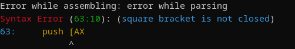
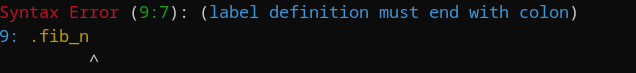

# kamen' - виртуальный процессор


## Описание
Данный проект содержит в себе виртуальный процессор (SPU), а также ассемблер, который компилирует команды в байткод для него.

У процессора также есть видео память. Её состояние можно отобразить в консоли через команду `disp`. В папке `./bad_apple` реализован скрипт, преобразующий произвольное видео в код на ассемблере - так любое видео можно проиграть на данном процессоре в разрешении `80x60`. 
> Примечение: видео преобразуется в чёрно-белый формат

Уделено внимание обработке синтаксических ошибок в ассемблере - указывается причина ошибки, номер строки и столбца, где находится некорректный код.
<br>


Список поддерживаемых команд и их описание находятся в `src/listing.c`.
Примеры программ есть в папке `./examples`

## Конфигурация
В файле `src/spu/config/dbg_config.h` находятся константы и флаги для конфигурации режима дебаггинга. Манипулируйте ими по необходимости.

В файле `secstack/src/config/secstack_config.h` также находится конфигурация стека, используемого данным процессором. Поменяв там константы, вы можете например заставить процессор работать с типом данных `float`, вместо `int` по умолчанию. Более подробная информация о проекте `secstack` находится [здесь](https://github.com/not-lum/secstack).

## Ограничения ассемблера
Описаны в `src/assembly/pasrsing_utils.h`:
* Максимальная длина операции - `9`
* Максимальная длина аргумента - `29`
* Максимальная длина метки - `29`
* Максимальное количество меток - `1024`

При несоблюдении этих лимитов поведение программы не определено.

## Запуск и компиляция
Для компиляции ассемблера, из корня запустите:
```bash
./compile_asm.sh 
```
Код скомплируется в `./asm`. Использование:
```bash
./asm <input_file> <output_file>
```
> Примечание: `./asm` также генерирует листинг кода в `.kamen_listing.log`

Для компиляции процессора:
```bash
./compile_spu.sh
```
Результат скомпилируется в `./spu`. Использование:
```bash
./spu <file_with_bytecode>
```


